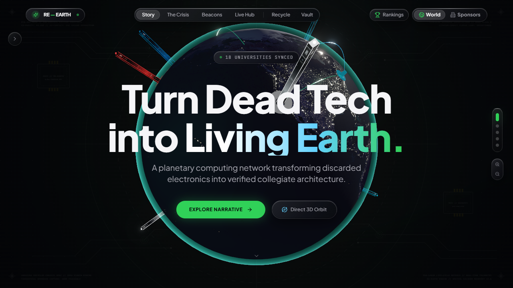
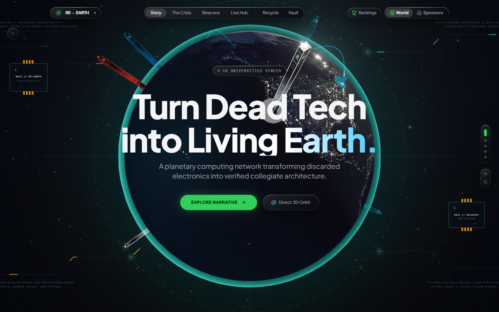
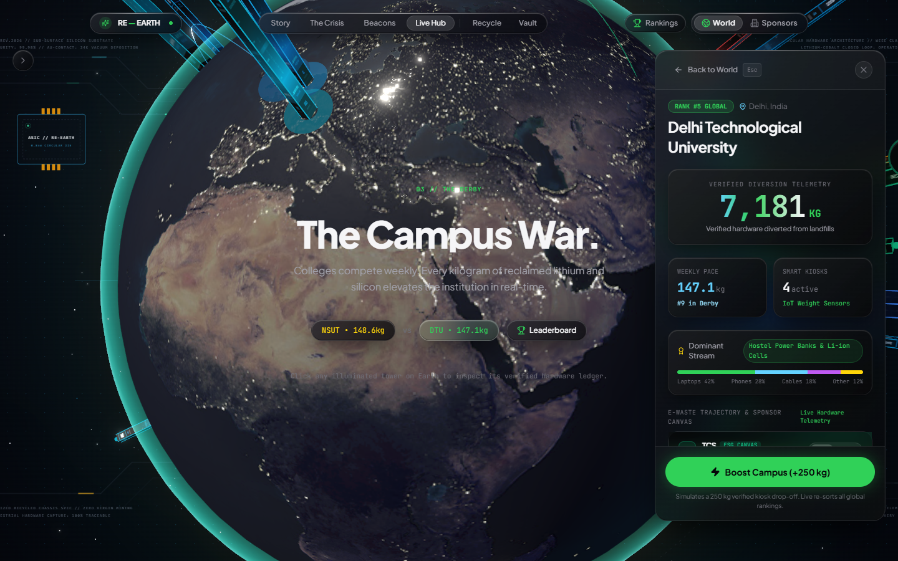
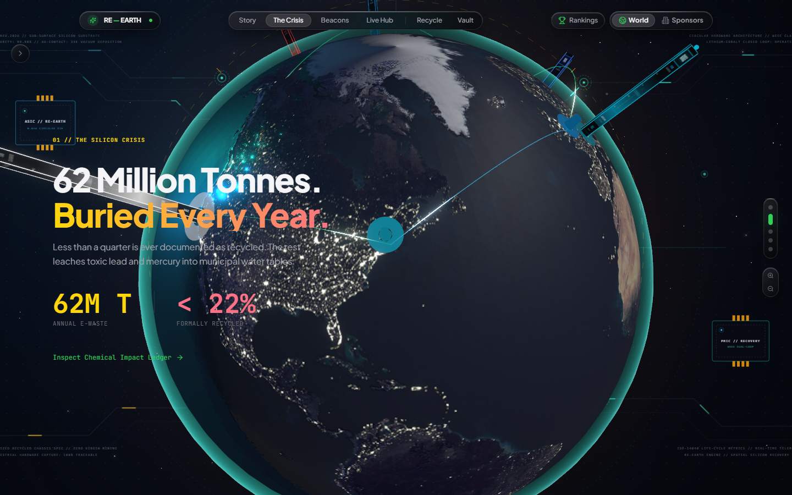
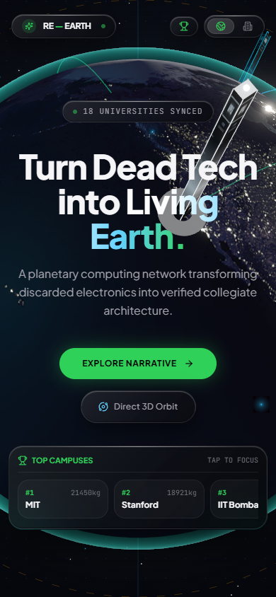

# RE—EARTH 🌍⚡
### Planetary E-Waste Telemetry & Collegiate Circular Architecture

> **"Turn dead tech into living Earth."**  
> An Apple Vision Pro-inspired planetary computing instrument transforming verified e-waste drop-offs into living 3D collegiate architecture, powered by dynamic corporate ESG sponsorships and real-time WebGL graphics.

---



---

## 🌟 Key Highlights

### 1. 🏙️ 3D Sponsor-Wrapped Campus Towers
Every participating university rises as a three-dimensional holographic beacon directly from its geographic coordinates on the globe. The **entire visible surface of each college tower functions as its corporate sponsor's branded canvas** (Apple, Tesla, Google, Intel, Nvidia, TCS, Infosys, Tata).
- Procedural dynamic canvas textures synthesized at runtime.
- Tower height directly visualizes verified kilograms of hardware diverted from landfills.
- Metallic top caps and emissive corner rails dynamically illuminate in the sponsor's corporate colorway.

### 2. 🪟 Authentic Apple VisionOS Liquid Glass Material
- Multi-layer glass material featuring directional ambient gradient sheens (`linear-gradient(135deg, ...)`).
- Dual-layer specular edge highlights (`inset 0 1px 1px 0 rgba(255, 255, 255, 0.22)` top highlight + `inset 0 -1px 1px 0 rgba(0, 0, 0, 0.45)` bottom refraction shadow).
- Micro-beveled `.specular-rim` highlights that catch simulated environmental lighting.
- Tactile spring physics with `scale(0.97)` active compression on all high-value controls.

### 3. 📜 Cinematic 5-Chapter Scroll-Driven Narrative
- Integrated **Lenis v1.3** smooth-scroll physics engine with cubic Hermite camera dampening.
- Masked typography reveals: headlines glide vertically into view through soft overflow-mask boundaries.
- Seamless decoupling: background 3D canvas allows direct pointer rotation, zoom, and pitch without scroll trapping.

### 4. 🌊 Real-Time Planetary Energy Shockwaves & Photonic Arcs
- **Planetary Energy Shockwave:** When a campus diversion is boosted (+250 kg), an expanding GLSL circular shockwave radiates across the Earth's crust from the university's latitude/longitude.
- **Reactive Great-Circle Arcs:** Photon particles stream $4\times$ faster along connected arcs, transmitting energy directly to partner institutions.
- **Rooftop Beacon Flare:** Tower beacons flare white with luminescent energy surges before settling back to sponsor tones.

### 5. 🔍 Proximity Clustering & Exploded Tangential Layout
- Global macro overview clusters tightly packed universities (e.g. Delhi NCR, Bay Area) into unified spatial beacons.
- Regional zoom smoothly fans out towers along tangential micro-arcs, ensuring zero collision or visual overlap.

### 6. 🌌 Living Sub-Silicon Environment & Atmospheric Aurora
- **Midnight Obsidian Substrate:** Multi-stop deep space gradient (`#05070D` base with layered `#0C1628` ellipse mesh) replacing flat black with cosmic depth.
- **Chapter-Reactive Atmospheric Halo:** 130vw living atmospheric halo behind the globe that breathes organically (`14s` period) and dynamically shifts color profiles across narrative chapters:
  - *Genesis:* Celestial deep cyan, verdigris & reclaimed copper.
  - *The Crisis:* Smoldering e-waste copper & lithium amber.
  - *Beacons:* Luminous verdigris & beacon teal.
  - *The Derby:* High-voltage competitive emerald & trophy gold.
  - *Circular OS:* Closed-loop cyan & silicon lavender.
- **Traveling Electronic Trace Pulses:** Staggered SVG dash-offset currents streaming along PCB bus lines from outer IC packages (`ASIC // RE-EARTH` and `PMIC // RECOVERY`) into central planetary orbits.
- **Deep Space Stellar Depth:** Three.js `<Stars>` and floating cosmic `<Sparkles>` micro-particles providing authentic 3D parallax on camera navigation.
- **Spatial Specular Lens:** Cursor-tracking radial spotlight illuminating fine circuit traces and optical fiducials.

---

## 📸 Interface Gallery

| Feature | Visual Preview |
|---|---|
| **Cosmic Horizon & Sub-Silicon Background** |  |
| **Campus Inspection Card & Live Boost** |  |
| **Chapter 1: The Crisis (Copper Horizon)** |  |
| **Mobile Responsive Adaptation** |  |

---

## 🛠️ Technology Stack

| Layer | Technologies |
|---|---|
| **Core Framework** | React 18.3, TypeScript 5.4, Vite 5.2 |
| **3D Graphics & WebGL** | Three.js 0.164, `@react-three/fiber` 8.16, `@react-three/drei` 9.105 |
| **Postprocessing** | `@react-three/postprocessing` 2.16 (Selective Bloom, MipmapBlur) |
| **Styling & Design System** | Tailwind CSS 3.4, Apple Liquid Glass CSS Engine |
| **Scroll Physics & Motion** | Lenis 1.3, Framer Motion 11.1, GSAP 3.12 |
| **Icons & Micro-Visuals** | Lucide React, Canvas Confetti |

---

## 📂 Project Architecture

```
re-earth/
├── public/
│   └── textures/              # 2K Earth Day, Normal, Specular & Night textures
├── screenshots/               # High-fidelity visual previews & audits
├── src/
│   ├── components/
│   │   ├── narrative/         # Pinned schematic background
│   │   ├── ui/                # Apple Liquid Glass UI components
│   │   │   ├── TopNav.tsx     # Sliding segmented pill header
│   │   │   ├── ScrollStorySections.tsx # 5-chapter masked narrative
│   │   │   ├── CampusInspectionCard.tsx # Detailed telemetry sheet
│   │   │   ├── TopTenDrawer.tsx # Collapsible global leaderboard
│   │   │   ├── WeeklyDerbyTicker.tsx # Rivalry matchup ticker
│   │   │   ├── ClusterSelectionPopover.tsx # Regional cluster chooser
│   │   │   ├── ScrollProgressHUD.tsx # 5-dot orbital track
│   │   │   └── Modals.tsx     # VisionOS modal sheets
│   │   └── world/             # 3D WebGL Canvas Scene
│   │       ├── WorldScene.tsx # R3F Canvas & lighting setup
│   │       ├── Earth.tsx      # Multi-texture Earth with atmosphere shader
│   │       ├── CampusTowers.tsx # Sponsor-branded 3D towers & beacons
│   │       ├── LightArcs.tsx  # Great-circle circularity light arcs
│   │       ├── PlanetaryShockwave.tsx # Expanding crust energy ripple
│   │       ├── SponsorSkyline.tsx # Night-city sponsor skyline view
│   │       └── CameraController.tsx # Hermite camera path & drag physics
│   ├── data/                  # Campuses, regions, and sponsor definitions
│   ├── hooks/                 # useLenis smooth scroll hook
│   ├── shaders/               # GLSL atmosphere and arc shaders
│   ├── store/                 # Zustand global world store
│   ├── styles/                # Liquid Glass CSS engine & design tokens
│   └── utils/                 # Geo math, clustering, and canvas banner generator
├── tailwind.config.js         # Apple color tokens, spring curves & shadows
└── vite.config.ts             # Vite config with GLSL shader support
```

---

## 🚀 Getting Started

### Prerequisites
- Node.js (v18 or higher recommended)
- npm or yarn

### Installation

1. **Clone or navigate to the repository:**
   ```bash
   cd re-earth
   ```

2. **Install dependencies:**
   ```bash
   npm install
   ```

3. **Start the development server:**
   ```bash
   npm run dev
   ```
   Open your browser at `http://localhost:5173` (or the port specified by Vite).

4. **Build for production:**
   ```bash
   npm run build
   ```

5. **Preview production build:**
   ```bash
   npm run preview
   ```

---

## 🕹️ Controls & Navigation

- **Scroll Down / Up:** Drives the 5-chapter cinematic narrative and smoothly moves the camera along the orbital trajectory.
- **Click & Drag on Canvas:** Freely orbits and pitches around the 3D Earth without interrupting page scrolling.
- **Zoom In / Out:** Use mouse wheel or the glass HUD zoom controls (`+` / `-`).
- **Click on Any Tower:** Focuses the camera directly onto that university and slides open the `CampusInspectionCard`.
- **Rankings Pill:** Expands the live Top 10 global leaderboard.
- **Boost Campus (+250 kg):** Simulates a verified kiosk drop-off, triggering the planetary shockwave, arc photonic surge, and live global rank recalculation.

---

## 📄 License

MIT License. Designed and engineered for the RE-EARTH planetary sustainability mission.
